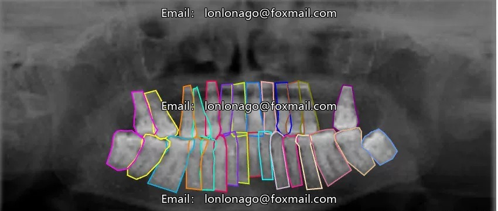
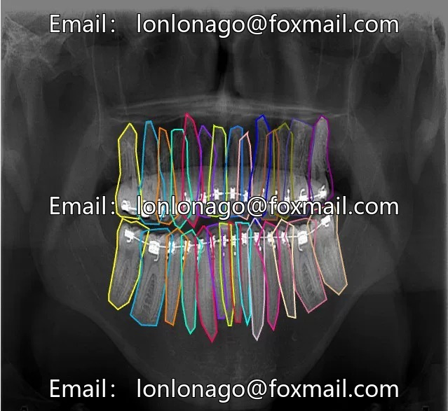
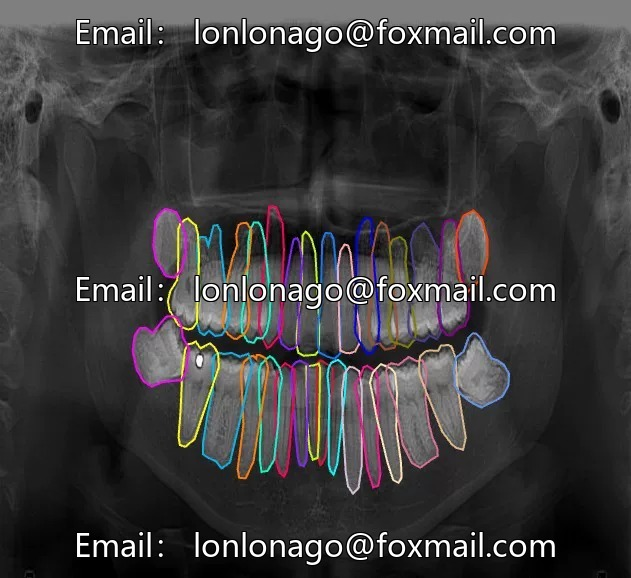
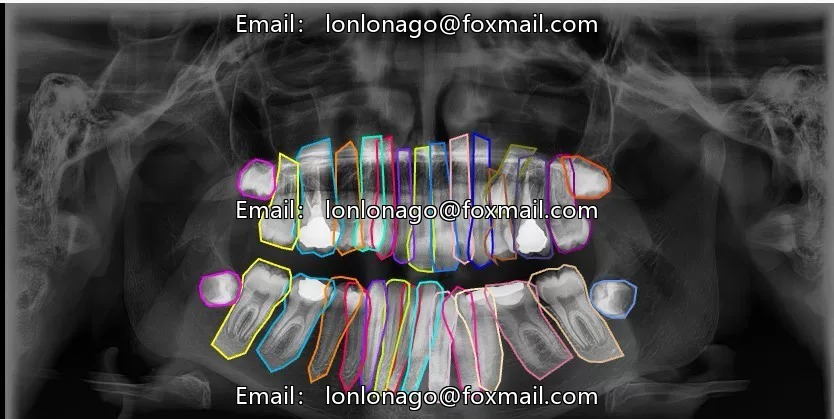
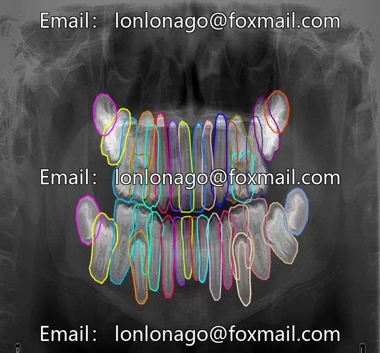

# Intelligent medical AI, medical MRI image, tooth segmentation dataset, containing 2332 images.

## Body

Intelligent Medical AI Medical MRI Image Teeth Segmentation Dataset, comprising 2332 image data, 33 sub-datasets, and 53 specific categories
The dataset focuses on the task of precise instance segmentation for oral teeth, with accurate labeling of individual tooth boundaries and regions.
It is suitable for the development of computer vision models related to oral medicine, aiding doctors in quickly localizing tooth positions and recognizing tooth features.
Supports data training for applications such as three-dimensional tooth reconstruction and orthodontic treatment simulation.
The data format is image files, supporting image drag-and-drop upload and device browsing loading.
Virtual materials are non-refundable once sold.
Interested friends can click "I want" now.

## Images

## Payment

Here is a pay link on Stripe ( https://buy.stripe.com/3cs8yP7sY87d0vu9AB ). Please contact me lonlonago@foxmail.com after funding $89, and I will send you a complete data files , thank you!

